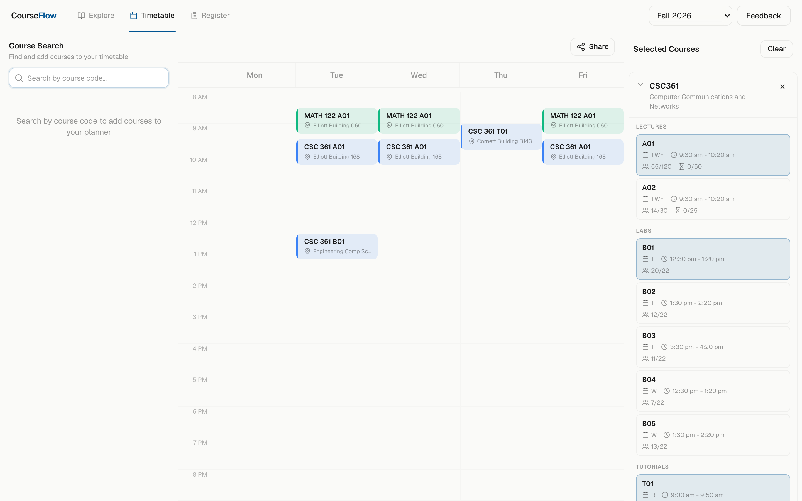

# CourseFlow

A course scheduler for the University of Victoria. Search the catalog, compare sections with live enrollment counts, and build a conflict-free timetable. Live at **[courseflow.smccl.ca](https://courseflow.smccl.ca)**.

<p align="center">
  
</p>

Fourth iteration of the project: it started as a Go CLI scraper, grew into a Go + React + MySQL app on a VPS, and was rewritten for Cloudflare's edge to run entirely on the free tier.

## Stack

- Preact + Signals, Hono on Cloudflare Workers
- Course data as static JSON; D1 only for saved schedules
- Biome, TypeScript, Vitest

## Layout

- `catalog/`: Node scripts that fetch UVic's data and build `public/data/terms/<term>.json`. `catalog/term.ts` is that file's shape.
- `app/`: the Preact app.
- `worker/`: the Hono API.

## Development

In this project, we use [nub](https://github.com/nubjs/nub?og), and no that's not a typo for bun.

```bash
nub ci
nub run catalog:fetch courses        # Kuali, into data/raw
nub run catalog:fetch sections 202609  # Banner, one term at a time
nub run catalog:build                # data/raw → public/data/terms
nub run dev
```

`nub run check`, `nub run typecheck`, and `nub run test` must pass before deploying with `nub run deploy`.
